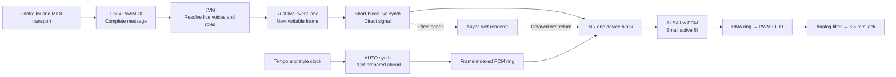

# Low-latency MIDI on the Raspberry Pi 3 analog jack

[Slovenský sprievodca](README.sk.md) · [48 measured onsets](measurements/man-onsets.csv) · [ALSA example](examples/adaptive_pcm.c) · [Analog measurement tool](examples/measure_loopback.py) · [Experimental PWM/DMA driver](driver/)

We wanted the first sound under a player's fingers to arrive quickly while an automatic accompaniment had time to prepare. On a Raspberry Pi 3 Model B, the tested path reached **3.594 ms p95 and 7.031 ms maximum** from complete MIDI-message reception to estimated DMA onset. **46 of 48** isolated note attacks were below 4 ms. This used a virtual MIDI source on the physical Pi, a custom ALSA device and the board's analog output path. The electrical signal at the jack and the key scanner were outside the instrumented interval. A player using a physical Roland confirmed the faster feel on an earlier build.

The useful result is the architecture. Keep live notes and hardware playback on a short path. Prepare the work that can be predicted on another path. Measure timing at each boundary and protect the handful of threads that have a deadline.

## Where the time goes



**Input.** The parser assembles a complete MIDI message, retaining running status and accepting interleaved MIDI realtime bytes. The timestamp for this study is taken after the complete Note On arrives. A physical controller adds key scanning, serialization and adapter or USB transport. Classic DIN MIDI transfers a byte in 320 µs at 31.25 kbit/s. A three-byte Note On occupies 0.96 ms on the wire. Running status can reduce the message length. An electrically compliant optocoupled UART input may remove a USB adapter and its variability while retaining the DIN serialization cost. [MIDI Association electrical specification](https://midi.org/wp-content/uploads/wpforo/default_attachments/1709416667-ca33-MIDI-10-Electrical-Specification-Update.pdf)

**Live sound.** The existing music engine resolves the active voice, transposition, pedal and expression before dispatch. Events go to a live queue measured in absolute PCM frames. The next writable block can see them. The dry sample is rendered at the active gain and enters the first suitable block. Preloaded presets and sample pages keep loading and file I/O away from the attack. Keep Note Off and pedal release ordered with their corresponding attack, including when the transport changes.

**Accompaniment.** The style clock runs ahead and delivers timestamped events plus a watermark indicating that earlier events have been sent. The AUTO synth runs on a separate worker. It writes completed stereo blocks to a bounded queue indexed by absolute frame and transport generation. The device thread consumes a matching block and can continue playing the live voice if a backing block is late. A scene change follows the musical clock. Stop invalidates queued backing from the old generation, while the live voice and its Note Off route survive. Audio already accepted by ALSA drains in device time.

In the measured profile the clock allowed **60 ms** for AUTO scheduling and delivery, the PCM ring held up to **40 ms** of prepared accompaniment, and the live renderer still filled a short hardware queue. About 40 ms of ready PCM is a capacity for a different stage from the 60 ms scheduling budget. Adding both as a fixed 100 ms delay double-counts the time during which work can overlap. Align backing, transport and sync markers on the intended output frame.

**Effects.** Dry notes travel directly to the mix. The optional reverb and chorus return used an asynchronous lane delayed by 384 frames, about 4.35 ms at 88.2 kHz. A wet block is tagged with its target output frame. The mixer uses one master gain after summing. A chorus or effect patch with no substantial dry transient requires a musical choice about its onset, and a lookahead limiter in the direct lane brings its lookahead cost back.

## Period size, ring capacity and active fill

A **frame** contains one sample per channel. For stereo S16, a frame is four bytes. A **period** is a unit the driver uses to report progress and wake the client. An ALSA **buffer** is the negotiated capacity. **Active fill** is the amount you actually queue before the device consumes it. These numbers have separate effects on latency.

| Geometry or policy | Time at the given rate |
| --- | ---: |
| 444 frames at 44.1 kHz, stock period on our system | 10.07 ms |
| 970 frames at 44.1 kHz, stock capacity on our system | 22.00 ms |
| 32 frames at 88.2 kHz, experimental period | 0.363 ms |
| 1,024 frames at 88.2 kHz, experimental capacity | 11.61 ms |
| 128 frames at 88.2 kHz, initial adaptive fill | 1.45 ms |
| 192 frames at 88.2 kHz, fill after a test XRUN | 2.18 ms |

We kept the larger physical ring. In steady state the writer admits another period only when the queue after that write will fit the target:

```text
available_frames >= capacity_frames - target_frames + period_frames
```

Prime to the target with ALSA autostart disabled and then call `snd_pcm_start`. Use negotiated parameters and measure `snd_pcm_avail_delay` around a monotonic timestamp. Test the actual route with `hw:` when you need to establish what the device accepts, since a plug or audio-server route can add conversion and change buffering. [ALSA PCM and the hardware/software parameter model](https://www.alsa-project.org/alsa-doc/alsa-lib/pcm.html)

During a recoverable playback underrun (`-EPIPE`), prepare the same PCM handle, raise the target, prime and start. Keep the engine's voices and transport state live. The experiment used a short fade-in after recovery and rebuilt the frame-to-time mapping when the device ran again. A failed block may be omitted if its samples have already advanced the synth. Replaying that block could duplicate an attack. Device removal, uncertain partial writes and repeated recoveries in a short interval need their own error paths.

Our adaptive mode added two periods on the first underrun. A burst raised the target more quickly, up to 896 frames at this geometry. After 30 seconds of continuous writes it reduced the target by one period toward the starting value. A forced 18 ms stall caused one recovery during a held note. The target rose from 128 to 192. PCM prepare took 101 µs and the first nonzero block was written 325 µs after recovery started. The 18 ms stall, reprime time to audible output and analog path are separate terms. Subsequent observations showed the queue decline by one period. [Standalone adaptive ALSA example](examples/adaptive_pcm.c)

## Why the Pi 3 driver mattered

On our Pi, the stock headphone route used the firmware audio path. One working setting negotiated 444-frame periods and 970-frame capacity at 44.1 kHz. In separate stress tests of a patched firmware path, requests around 12–14 ms produced a firmware completion flagged as an error after roughly 10 ms between notifications. The trace showed that the userspace test thread received CPU within 9 µs of waking in those cases. Reducing the userspace write size alone could not remove that driver's observed timing constraint. These results apply to the specific tested firmware and driver. [Pinned Raspberry Pi Linux driver source](https://github.com/raspberrypi/linux/blob/cff533aec2fa601846766b32ff57204e0a61bed7/drivers/staging/vc04_services/bcm2835-audio/bcm2835-pcm.c#L52-L80)

The [DirectJack prototype](driver/) registers an ALSA playback device, converts S16 stereo PCM to PWM duty words as the application commits frames, and feeds a cyclic DMA ring paced by the PWM FIFO's DMA request. The driver's hardware pointer comes from DMA residue. On the Raspberry Pi 3 Model B, the on-board filter carries the PWM signal to the analog AV jack. Firmware audio and this driver must have exclusive ownership of that PWM hardware. [Pi 3 Model B schematic](https://www.raspberrypi.org/documentation/hardware/raspberrypi/schematics/rpi_SCH_3b_1p2_reduced.pdf) · [Linux DMAengine cyclic API](https://docs.kernel.org/driver-api/dmaengine/client.html)

The tested code uses a 98.784 MHz PWM clock target and a range of 560. It sends four carrier intervals per PCM frame at 44.1 kHz and two at 88.2 kHz, giving a nominal carrier of 176.4 kHz per channel at either audio rate. Direct rounding of duty values provides few levels. The fractional accumulator carries quantization error forward independently per channel and alternates integer duties when necessary. Exact digital silence maps to the midpoint without injecting idle dither. The listener reported less signal-dependent noise after this change. This repository has no calibrated analog noise-floor or distortion measurement.

## What moved the latency tail

All MIDI numbers in the following table are receive-to-estimated-DMA measurements. Percentiles use nearest rank and include the first note. Configuration changes took place across separate boots. They illustrate where to experiment and how to spot trade-offs.

| Pi 3 run | Notes | p95 | Maximum | Observation |
| --- | ---: | ---: | ---: | --- |
| Earlier fixed 128-frame run | 48 | 3.274 ms | 5.052 ms | Fast live path with scheduled AUTO events |
| Adaptive fill and separate AUTO PCM | 48 | 4.538 ms | 15.325 ms | Slowest attack spent about 13.4 ms before voice enqueue |
| Added realtime priority on the JVM MIDI input thread | 48 | 3.577 ms | 4.901 ms | Shared CPU placement coincided with an AUTO gap of about 56 ms |
| Placed the backing renderer on a separate CPU | 48 | 3.594 ms | 7.031 ms | Two missing backing blocks before the first backing audio and zero afterward in this pass |

In the last configuration, CPU 3 ran the ALSA renderer at `SCHED_RR/5`. CPU 2 ran the JVM MIDI input at `RR/4` and the live event dispatcher at `RR/3`. CPU 1 ran the accompaniment clock and event pump. CPU 0 ran the backing renderer at `RR/2`. The numbers are Linux thread priorities and a tested placement on one machine. Audio servers and other hardware can have different IRQ and housekeeping requirements. Measure where work runs before copying the layout. [Linux scheduling policies](https://man7.org/linux/man-pages/man2/sched_setscheduler.2.html) · [CPU isolation and housekeeping](https://docs.kernel.org/admin-guide/cpu-isolation.html) · [Realtime bandwidth](https://docs.kernel.org/scheduler/sched-rt-group.html)

At 88.2 kHz, reducing the target from 128 to 96 frames saves at most one 0.363 ms period of queue time at the same fill phase. The separate 96-frame trial had a worse end-to-end p95 of 5.972 ms. In that run the slowest sample spent 5.154 ms around the JVM-to-Rust delivery boundary. A fast device can leave the event handoff as the limiting factor. Instrument before and after the JVM write and around the reader's wakeup to separate computation, pipe backpressure and scheduling.

Another trace caught the PCM thread waiting in `filemap_fault`, followed by an instruction fault waiting on page migration in a later run. Prefaulting and locking selected renderer code mappings and warm sample pages reduced this risk. We temporarily disabled compaction of unevictable pages during isolated tests and restored it afterward. Consider memory headroom, warming code paths and avoiding synchronous logging, allocation, filesystem access and unbounded locks in the render loop before changing global VM policy. A smaller period creates more wakeups per second. [Linux VM compaction policy](https://docs.kernel.org/admin-guide/sysctl/vm.html#compact-unevictable-allowed) · [Timerlat and OS-noise tools](https://docs.kernel.org/tools/rtla/rtla-timerlat-top.html)

## How to measure your setup

1. **Record a baseline.** Capture board, kernel, backend, negotiated sample rate and period, actual queue depth, CPU load, XRUNs and the input transport. Compare identical patches, input cadence, warm-up and background load.
2. **Add timestamps to the audio path.** Stamp complete MIDI reception, voice delivery and the first committed nonzero PCM frame after a quiet interval. Associate that frame with observations from the same PCM epoch. With an observation of submitted frame index `s`, delay `d`, rate `r` and observation time `t`, the estimate for frame `n` is `t + (n - (s - d)) / r`. Bracket the ALSA call with monotonic clock reads and retain the bracket width. Stop estimating across an XRUN until the mapping is valid again.
3. **Measure the electrical result.** Use one stereo line-level ADC or scope with a shared timebase. Channel 1 receives a safe, conditioned reference from the event generator. Channel 2 receives the Pi jack output. A marker at the start of DIN transmission includes serialization. A marker after completing the message measures a different interval. Drive repeated MIDI notes with deliberate gaps, pick a dry patch with a clearly measurable first transient and report your thresholds. Calibrate relative channel skew by feeding the same safe reference to both inputs, then use the waveform and reported per-trial offsets to verify edge pairing. Match voltages, attenuation and isolation to your interface. TTL GPIO, DIN current-loop signals and line inputs require appropriate conditioning.
4. **Test the tail and the musical result.** Keep cold first notes, count missing and ambiguous pairs, retain p50/p95/p99 and maximum, and perform several runs under actual load. Test repeated attacks, a held note spanning Stop and Ending, release, dense expression traffic, effect toggles, a scene change and a deliberate controlled underrun. A JACK audio-loopback tool measures the audio round trip. The reference waveform in step 3 lets you define a one-way MIDI-to-jack measurement. [JACK latency API](https://jackaudio.org/api/group__LatencyFunctions.html)

The [loopback analyzer](examples/measure_loopback.py) uses Python's standard library. Feed it a stereo PCM16 WAV with the reference on channel 1 and the jack response on channel 2. It reports detected pairs, missing or ambiguous trials and nearest-rank latency statistics. It is designed for isolated attacks with quiet gaps and supports measured channel-skew correction. The [measurement notes](measurements/README.md) describe the published data and which boundary each column covers.

## Where to go next

- **Keep the event chain short.** The measured late tail suggests a timestamped binary queue or a dedicated live dispatcher that avoids text formatting and request/response contention. Extract only the attack-critical decisions, precompute register state, and check identical pitch, gain and release semantics before bypassing an existing music engine.
- **Keep resampling and effects out of the fastest lane when possible.** A faster output clock can shorten a hardware period even when a slower backing synth spills into a precomputed resampling stage. Resampler group delay, dry/wet alignment and passband artifacts still matter. Benchmark CPU deadline misses at each rate.
- **Compare output hardware with the same electrical trigger.** I²S with a supported ALSA driver and a DAC such as PCM5102A can change noise and output quality. Latency also depends on the driver, minimum period, FIFO, converter filter group delay and the application queue. The datasheet documents distinct filter modes. There is no measured I²S or USB result for this low-latency profile. [TI PCM510xA datasheet](https://www.ti.com/lit/ds/symlink/pcm5102a.pdf) · [Raspberry Pi I²S peripherals guide](https://pip-assets.raspberrypi.com/categories/1259-audio-camera-and-display/documents/RP-009699-WP-1-Using%2520the%2520I2S%2520peripherals%2520on%2520Raspberry%2520Pi%2520SBCs.pdf)
- **When working through an audio server, measure the negotiated graph.** JACK reports per-port latency ranges. PipeWire quantum and rate are graph-wide constraints affected by other nodes. Test the settings on a dedicated session and include the real hardware route in your measurement. [JACK latency API](https://jackaudio.org/api/group__LatencyFunctions.html) · [PipeWire graph properties](https://pipewire.pages.freedesktop.org/pipewire/page_man_pipewire-props_7.html)

## Code and verification

- The ALSA C example is a standalone playback loop for a device you choose. See [build and run](examples/README.md).
- The Python analyzer includes hardware-free fixture tests. It lets a new build or output path be checked against an electrical reference recording.
- The kernel module is the GPL-2.0-only prototype from the evaluated Pi 3 setup. Its [driver guide](driver/README.md) lists its validated target, prerequisites, and rollback. The tested driver, examples and measurement notes are separate components.

The article, data and examples are available under the [MIT license](LICENSE). The [driver directory](driver/COPYING) uses GPL-2.0-only.
